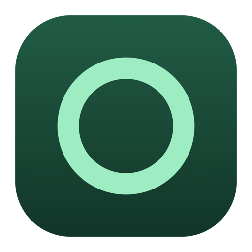
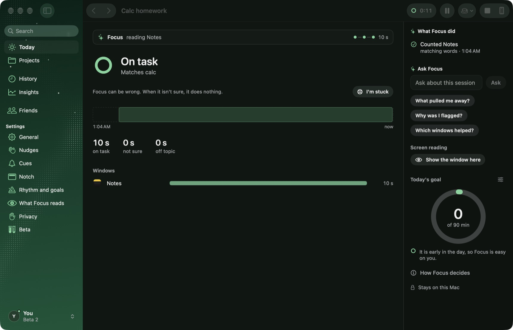
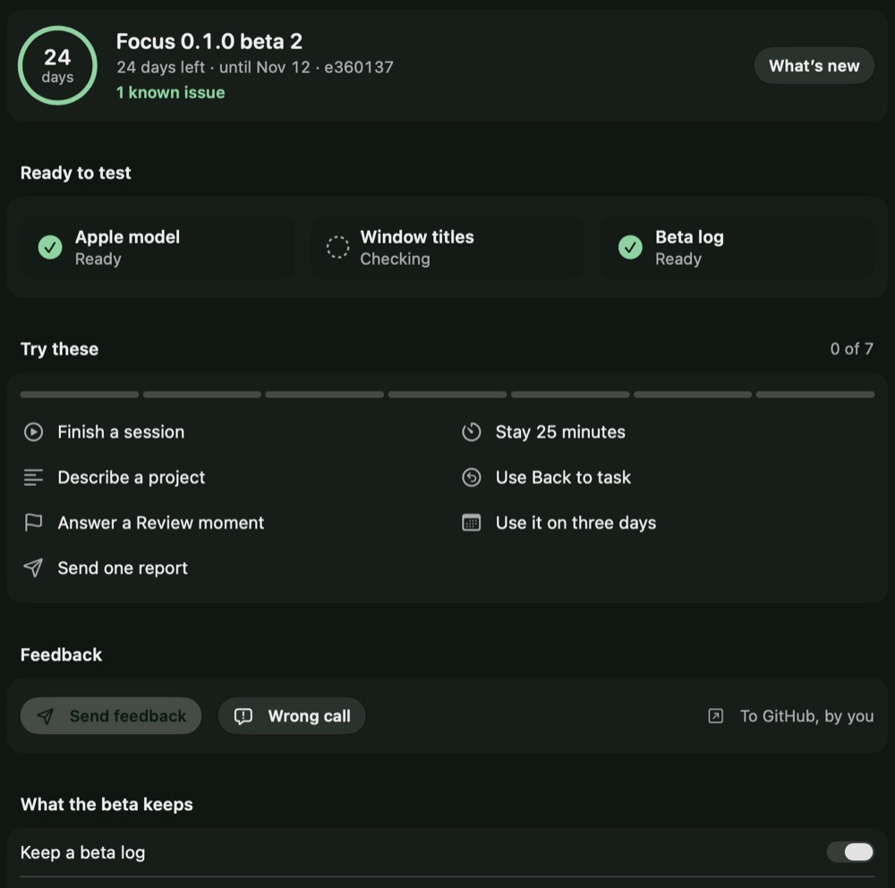

<p align="center"></p>

<h1 align="center">Focus</h1>

<p align="center">A calm focus app for Mac. You say what you are working on, Apple's on-device model compares the window in front with it,<br>and Focus nudges you back when you drift.</p>

<p align="center">
  <a href="https://github.com/Aryan61056/focus-app/releases"><b>Download the beta</b></a> &nbsp;·&nbsp;
  <a href="docs/beta/TESTER-GUIDE.md">Tester guide</a> &nbsp;·&nbsp;
  <a href="https://github.com/Aryan61056/focus-app/issues/new/choose">Send feedback</a>
</p>

<p align="center"></p>

## Join the beta

**You need** a Mac with Apple silicon and Apple Intelligence turned on (System Settings › Apple Intelligence & Siri). Built and tested on macOS 27.

1. **Download** the `.dmg` from the [newest release](https://github.com/Aryan61056/focus-app/releases).
2. **Install.** Open it and drag Focus onto Applications.
3. **Open it once by hand.** This beta has no Apple developer signature yet, so macOS stops it the first time. Choose **Done**, then **System Settings › Privacy & Security › Open Anyway**. Once per build.
4. **Allow Accessibility** when Focus asks, so it can read window titles and not only app names.
5. **Start a session** with what you are working on, then work as usual.

Use it for real work on at least three days over about a week. Your name at the bottom left of the Focus window opens your profile; its **Beta page** checks that your Mac is ready and lists seven things to try, which tick themselves as you go.

A newer beta installs over the old one, and your sessions and settings stay. When a build passes its end date it keeps working, and the profile offers **Get the newest build**.

## Send feedback



In Focus, click **your name at the bottom left**, then **Send feedback** (or Help › Send Feedback, ⌥⌘F).

1. Pick what it is: something broke, a wrong call, an idea, or anything else.
2. Say what happened in your own words. For a wrong call, describe the *kind* of window ("a PDF of my lecture notes"), not what was in it.
3. Press **Post on GitHub**. Focus saves the report and opens the form here; drag the file in, read it, and submit.

Or open a form directly: [Something broke](https://github.com/Aryan61056/focus-app/issues/new?template=beta-bug.yml) · [Wrong call](https://github.com/Aryan61056/focus-app/issues/new?template=beta-wrong-call.yml) · [Idea](https://github.com/Aryan61056/focus-app/issues/new?template=beta-idea.yml)

**A report holds** your words, the build, your Mac's model and macOS version, whether permissions are on, your settings switches, counts, a log of when things happened (kinds and times), Focus's last calls (on, unsure or off, and how it decided), and where a crash happened. **It never holds** task or project names, window titles, web addresses, words from your screen or pictures. You see the whole file before it is saved, and Focus never sends a report by itself. Issues on GitHub are public.

<br clear="right">

## What Focus does

- **Reads the window in front** (its app, title and address, and with screen reading on, its words) and compares it with your task. The judging runs on your Mac with Apple's on-device model. No account, no cloud model.
- **Leans toward doing nothing.** Focus can be wrong. When it isn't sure, it does nothing, and a nudge needs several readings that agree.
- **Nudges gently** and never names the distraction. **Back to task** returns you to the window or tab you were working in.
- **Shows its work.** Today shows what Focus is reading and why it decided; Review asks whether a flagged moment was right; Projects keep context between sessions.

This is an early beta. What changed and what is not verified yet: [docs/STATUS.md](docs/STATUS.md). The plan: [docs/PLAN.md](docs/PLAN.md). Working rules and decisions: [CLAUDE.md](CLAUDE.md). Design context: [PRODUCT.md](PRODUCT.md). "Focus" is a working name.

## Build from source

```bash
./tools/build_app.sh        # builds mac/.build/Focus.app (local, ad-hoc signed, dev only)
open mac/.build/Focus.app
```
First time: Settings, "What Focus looks at", press "Check in 5 seconds" and switch to another window to see what Focus can read. Allow Accessibility (window titles) in System Settings, Privacy & Security; Screen Recording only if you turn on screen reading. If you rebuild and permissions seem lost, remove Focus from the list and add it again once.

Shortcut: Control-Option-F starts a session (or pauses and resumes one).

```bash
(cd mac && swift test)                 # Swift tests (brain, judge, app logic)
python3 -m unittest discover -s eval/tests
python3 -m unittest discover -s tools/beta -p 'test_*.py'
python3 tools/check_privacy.py
./tools/check_notch_hover.sh           # moves your pointer onto the notch panel; needs the bundle built
FOCUS_E2E=1 swift test --filter RealModelE2ETests   # from mac/: real Apple model, scripted windows
```

## Making a beta

```bash
tools/beta/release.sh                  # builds the next beta: DMG, checksum, notes, known issues, invite, GitHub release text
tools/beta/publish.sh 0.1.0-beta.2     # puts that folder on GitHub as a pre-release (asks first)
tools/beta/feedback.py pull            # files the reports attached to `beta` issues, then: list, triage, report
```
How the whole loop works, and what is verified: [docs/BETA.md](docs/BETA.md).
